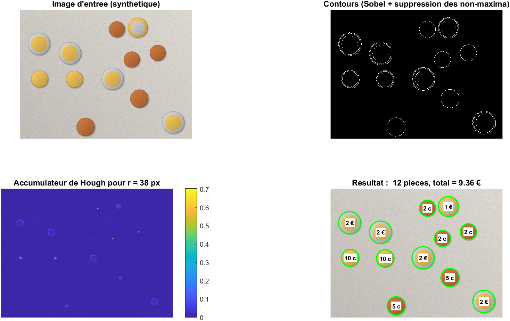

# Comptage de pièces en euros par transformée de Hough circulaire

Estimer le **montant total** d'un ensemble de pièces en euros à partir d'une seule photographie : détection, localisation sub-pixel, identification de chaque pièce et estimation de l'échelle métrique. Tout le pipeline est implémenté **sans toolbox**. Aucune fonction de détection, de morphologie ou de classification de haut niveau n'est utilisée, et les fonctions de toolbox (`imfindcircles`) ne servent que de référence de comparaison.



---

## 1. Formulation du problème

On observe une image $I$ contenant $K$ pièces inconnues. Pour chaque pièce $i$, on cherche :
- son centre $(x_i, y_i)$ et son rayon $r_i$ en pixels ;
- sa classe $k_i \in \{1\,c, 2\,c, 5\,c, 10\,c, 20\,c, 50\,c, 1\,€, 2\,€\}$ ;

puis le montant $M = \sum_i v(k_i)$.

**Hypothèses de travail** (et ce qui casse quand elles ne tiennent pas, voir §6) :
1. **Prise de vue orthographique** : l'axe optique est perpendiculaire au plan des pièces, donc une échelle $s$ (px/mm) unique pour toute l'image ($d_i = s\,D_{k_i}$).
2. **Pièces non superposées.** Elles peuvent se toucher.
3. **Éclairage à peu près neutre**, pour que la teinte mesurée reflète le métal.

**Difficulté centrale.** Le diamètre seul est **mal conditionné** :

| Pièce | 1 c | 2 c | 5 c | 10 c | 20 c | 50 c | 1 € | 2 € |
|---|---|---|---|---|---|---|---|---|
| Diamètre (mm) | 16,25 | 18,75 | 21,25 | 19,75 | 22,25 | 24,25 | 23,25 | 25,75 |
| Métal | cuivre | cuivre | cuivre | or | or | or | bimétal | bimétal |

Les diamètres des 8 pièces sont entrelacés. Deux pièces voisines en diamètre (2 c / 10 c, 20 c / 1 €, 1 € / 50 c) ne diffèrent que de **4 à 5 %**. C'est l'ordre de grandeur de l'erreur d'échelle sur une photo de téléphone, et le problème est **non identifiable** si l'échelle est inconnue. En conditionnant par le métal, l'écart minimal entre candidats passe à **≈ 9 %** (20 c / 50 c), et les deux pièces bimétalliques deviennent identifiables sans aucune mesure de taille.

---

## 2. Méthode

### 2.1 Contours
Lissage gaussien ($\sigma = 1{,}5$), gradient de Sobel $\nabla I = (g_x, g_y)$, puis **suppression des non-maxima** le long de la direction du gradient, quantifiée sur 4 axes. On garde les pixels tels que $\|\nabla I\| > 0{,}15 \max\|\nabla I\|$.

### 2.2 Transformée de Hough circulaire orientée
Un cercle $(a, b, r)$ passe par le pixel de contour $\mathbf{p}$ si $\mathbf{p} - (a, b)$ est colinéaire à la normale au contour, donc à $\nabla I(\mathbf{p})$. Chaque pixel de contour vote, pour chaque rayon $r$, pour **deux** centres seulement :

$$(a, b) = \mathbf{p} \pm r\,\frac{\nabla I(\mathbf{p})}{\|\nabla I(\mathbf{p})\|}$$

Le signe $\pm$ couvre les pièces plus claires et plus sombres que le fond. Le coût passe de $O(N_e\, N_r\, N_\theta)$ pour la Hough classique à $O(N_e\, N_r)$, avec $N_e$ pixels de contour et $N_r$ rayons testés.

L'accumulateur $A(a, b, r)$ est sommé sur un voisinage 3×3, pour tolérer une erreur d'orientation, puis **normalisé par le périmètre** $2\pi r$. Le score $A/2\pi r \in [0, 1]$ est la fraction du cercle effectivement observée, comparable d'un rayon à l'autre.

### 2.3 Extraction des cercles
Maxima successifs de l'accumulateur au-dessus de 0,30, suppression d'un disque de rayon $0{,}8\,r$ autour de chaque centre retenu, et interpolation parabolique du rayon. **Cercles concentriques** : le centre d'une pièce bimétallique et le liseré produisent des maxima au même centre. On retient le plus grand rayon dont le score vaut au moins 60 % du maximum.

### 2.4 Affinage sub-pixel du bord (`refine_circles.m`)
Le relief du liseré crée un contour **intérieur** parfois plus contrasté que le bord réel. Une erreur de 1 mm sur le diamètre suffit à confondre 10 c et 20 c. L'affinage procède en trois temps :
1. 180 profils radiaux $I(\rho, \theta)$ pour $\rho \in [0{,}8\,r,\ 1{,}2\,r]$, par interpolation bilinéaire ;
2. dérivée radiale **signée** (le signe de l'écart pièce/fond est estimé localement), médiane sur $\theta$, puis sélection du pic **le plus extérieur** parmi ceux qui dépassent 60 % du maximum ;
3. bord exact $\rho^*(\theta)$ sur chaque rayon, puis ajustement d'un cercle par **moindres carrés algébriques** (Kåsa) :
$$\min_{a, b, c} \sum_j \left(x_j^2 + y_j^2 - a x_j - b y_j - c\right)^2, \qquad r = \sqrt{c + a^2/4 + b^2/4}$$
avec deux itérations de **rejet robuste** : on écarte les points dont le résidu dépasse $3 \times 1{,}4826 \times \text{MAD}$ (ombre portée, pièce voisine en contact).

### 2.5 Descripteurs de couleur
Teinte et saturation moyennes (espace HSV) sur deux anneaux : le **centre** ($\rho < 0{,}45\,r$) et la **couronne** ($0{,}80\,r < \rho < 0{,}93\,r$). Règles de décision : saturation $< 0{,}22$ pour l'argent, sinon teinte $< 0{,}10$ pour le cuivre et l'or au-delà. On en déduit 4 classes de métal : cuivre, or, bi1 (centre argent, couronne or : 1 €) et bi2 (centre or, couronne argent : 2 €).

### 2.6 Identification et estimation conjointe de l'échelle (`classify_coins.m`)
À échelle connue, chaque pièce est classée au **plus proche voisin en erreur relative**, parmi les seuls candidats $\mathcal{C}(m_i)$ compatibles avec son métal :

$$k_i = \arg\min_{k \in \mathcal{C}(m_i)} \frac{|D_k - d_i/s|}{D_k}$$

L'erreur relative est le bon choix, car une erreur d'échelle est **multiplicative**.

À échelle inconnue, on résout le problème joint étiquettes / échelle :

$$\hat{s} = \arg\min_{s} \sum_{i=1}^{K} \min_{k \in \mathcal{C}(m_i)} \left(\frac{D_k - d_i/s}{D_k}\right)^2$$

Le $\min$ intérieur rend $J(s)$ **non convexe et à minima multiples**. On utilise donc une recherche exhaustive sur 2000 valeurs de $s$ dans $[\min_i d_i/27,\ \max_i d_i/15]$, un intervalle qui contient nécessairement la vraie échelle puisque $16{,}25 \le D \le 25{,}75$ mm. Le minimum global est garanti, au pas de grille près (< 0,1 % relatif).

**Identifiabilité.** L'échelle n'est déterminée que si l'image contient assez d'information. Une pièce bimétallique (1 candidat) **ancre** $s$. Plusieurs pièces de même métal fixent $s$ par leurs **rapports** de diamètres. En revanche, une pièce dorée isolée est compatible avec trois échelles à coût nul (10, 20 ou 50 c) : le problème est alors indéterminé et l'estimateur biaisé vers la plus petite échelle. Recommandation : inclure une pièce de 1 € ou 2 €, ou calibrer avec `calibrate_click`.

### 2.7 Calibration manuelle (`calibrate_click.m`)
On mesure $s = \|\mathbf{p}_2 - \mathbf{p}_1\| / L$ sur une longueur connue $L$. Pour une imprécision de clic $\sigma_c$, l'erreur relative vaut $\sqrt{2}\,\sigma_c / \|\mathbf{p}_2 - \mathbf{p}_1\|$. Il faut donc une référence **longue à l'écran** (règle de 100 mm plutôt que diamètre d'une pièce).

---

## 3. Protocole d'évaluation

### 3.1 Données synthétiques (`main.m`)
`coins_synth.m` génère des images avec **vérité terrain exacte** : fond texturé, dégradé d'éclairage, ombre portée, liseré sombre, gravures, flou optique et bruit gaussien. Deux régimes sont testés, sur 30 images chacun : pièces **séparées** et pièces **jointives**.

### 3.2 Données réelles (`eval_dataset.m`)
- **Roboflow euro_detection** ([lien](https://universe.roboflow.com/eurocoins/euro_detection), CC BY 4.0) : boîtes annotées par classe, converties en cercles ($r = (w + h)/4$).
- **Photos personnelles** avec montant de référence (`data/verite.csv`).

L'échelle est **inconnue** dans ce protocole : seule une plage de rayons relative à la taille de l'image est fournie.

### 3.3 Métriques
Une détection est un vrai positif si son centre est à moins de $0{,}3\,r$ d'une pièce annotée non encore appariée (appariement glouton).

| Métrique | Définition |
|---|---|
| Précision | VP / détections |
| Rappel | VP / pièces annotées |
| Taux d'identification | pièces bien classées / VP (sépare l'erreur de classification de l'erreur de détection) |
| Erreur de rayon | biais et écart-type de $\hat r - r$ sur les VP (px) |
| Montant exact | proportion d'images avec $\hat M = M$ (critère de bout en bout, le plus sévère) |
| Erreur de montant | $\mathbb{E}\,|\hat M - M|$ (€) |

---

## 4. Résultats

> Les valeurs ci-dessous sont celles affichées par `main.m` et `eval_dataset.m` (graine fixée, `rng(7)`).

| Jeu | Images | Précision | Rappel | Identification | Montant exact | Erreur moy. |
|---|---|---|---|---|---|---|
| Synthétique, séparées | 30 | … | … | … | … / 30 | … |
| Synthétique, jointives | 30 | … | … | … | … / 30 | … |
| Roboflow (échelle inconnue) | … | … | … | … | … | … |
| Photos personnelles | … | n/a | n/a | n/a | … | … |

| Figure | Contenu |
|---|---|
| `fig1_etapes.png` | Image, carte de contours, coupe de l'accumulateur au rayon dominant, résultat annoté |
| `fig2_couleurs.png` | Espace de décision teinte/saturation et seuils |
| `fig3_jointives.png` | Pièces en contact, bruit renforcé |
| `results/eval/*.png` | Résultats sur données réelles, vérité terrain en pointillés jaunes |

**Lecture critique.** Sur données réelles, on attend que les erreurs viennent d'abord de la **couleur** (balance des blancs, reflets spéculaires sur le métal), puis de l'**échelle** quand la photo ne contient aucune pièce bimétallique, et non de la détection elle-même.

---

## 5. Reproduire

```matlab
>> main            % synthétique : figures + métriques
>> eval_dataset    % données réelles (data/roboflow/ et/ou data/verite.csv)
```

- MATLAB R2021a ou plus récent, **aucune toolbox requise**.
- Résultats déterministes (graine fixée).
- Prise de vue recommandée : du dessus, fond uni et contrasté, pièces non superposées, au moins une pièce de 1 € ou 2 € (ou une règle pour `calibrate_click`).

```
main.m                 évaluation synthétique et figures
eval_dataset.m         évaluation sur données réelles annotées
src/hough_circles.m    contours (Sobel + NMS) et Hough circulaire orientée
src/refine_circles.m   affinage sub-pixel : profils radiaux + Kåsa robuste
src/coin_features.m    descripteurs HSV centre / couronne
src/classify_coins.m   plus proche voisin conditionné au métal + échelle conjointe
src/calibrate_click.m  calibration métrique manuelle
src/count_coins.m      pipeline complet
src/coins_synth.m      générateur d'images avec vérité terrain
src/match_detections.m appariement détections / vérité terrain
src/coin_table.m       caractéristiques officielles des pièces
```

---

## 6. Limites connues

| Hypothèse violée | Effet observé | Piste |
|---|---|---|
| Vue oblique | Cercles → ellipses, échelle non uniforme | Rectification par homographie (4 points ou motif connu), ou Hough elliptique |
| Pièces superposées | Bords partiellement cachés, rayon sous-estimé | Score sur arc partiel, modèle d'occlusion |
| Éclairage coloré | Confusion cuivre/or, centre argent mal détecté | Balance des blancs sur le fond, classifieur appris (k-NN / SVM sur HSV + diamètre) |
| Une seule pièce non bimétallique | Échelle indéterminée (§2.6) | Calibration ou référence connue dans la scène |
| Reflet spéculaire | Faux contours internes, couleur saturée | Rejet par cohérence centre/couronne, polariseur |

Le seuil de couleur et les seuils de Hough sont **réglés à la main** sur les données synthétiques. Leur transfert aux photos réelles est précisément ce que mesure `eval_dataset.m`.

---

## Licence

MIT. Données Roboflow : CC BY 4.0, auteurs du jeu *euro_detection*.